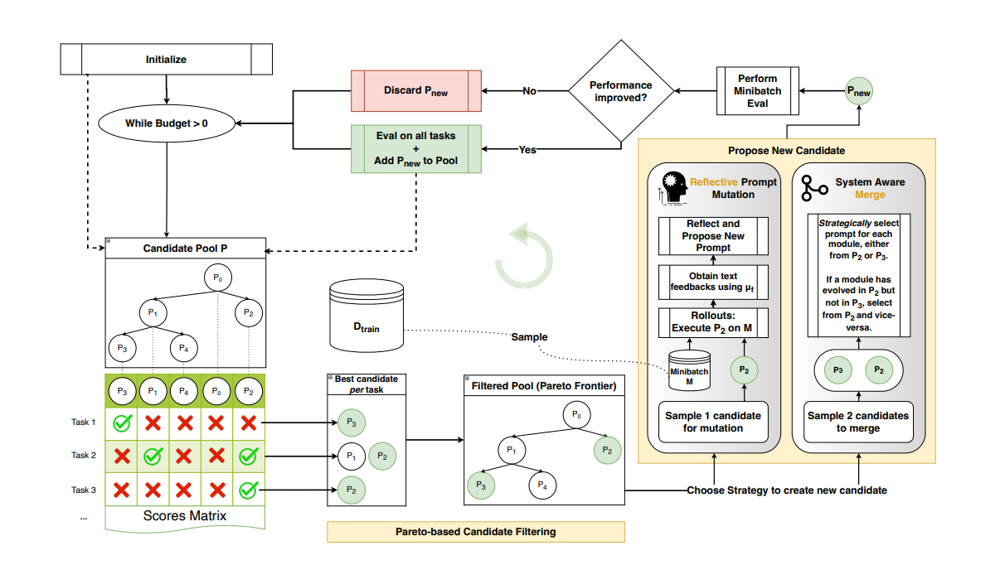

import Box from "@/components/Box.astro";

## Introduction
The set of instructions we send to an [LLM](https://en.wikipedia.org/wiki/Large_language_model) to get some response is known as a prompt. We already know that models are powered by [weights](https://www.ibm.com/think/topics/llm-parameters), which are adjusted during training to help the model learn patterns from data. The complete [training process](https://www.ibm.com/think/topics/llm-training), which can take hours to several days or even longer, aims to produce a model that performs better at its intended tasks.

But prompts also play a really significant role in how the model responds. Give it a broken or meaningless phrase, and it might generate irrelevant answers or start hallucinating, boiling the user's blood. But give it clear instructions that explain the problem and the goal, and you'll likely get a much better response.

There are ways, patterns, techniques that exist to optimise the prompts in order to get better results. In the coming sections we will walk through one of them, i.e., [GEPA](https://github.com/gepa-ai/gepa), directly from the research paper, and will see how it makes use of natural language feedback to optimise the prompts. 

## GEPA
[Genetic Pareto (GEPA)](https://github.com/gepa-ai/gepa) is a prompt optimisation technique introduced in July 2025, that uses natural language feedback and maintains the pareto front, while keeping the weights of the model constant.

GEPA has 3 core principles. 

1. Genetic prompt evolution - In biology, organisms evolve across generations. Their offspring inherit traits from their parents. GEPA takes the exact same idea to evolve and optimise the prompts. It takes feedback on existing prompts by testing them and improves the next prompt based on that. 

2. Natural Language feedback - The feedback is not binary or some other non-human-readable language, but a [natural language](https://en.wikipedia.org/wiki/Natural_language)-based feedback system to improve the prompts.

3. Pareto Based Candidate Selection - This is one of the core components of GEPA. **A prompt is Pareto optimal when there's no way to improve its score on one [golden](https://www.sprinklr.com/help/articles/set-up-nlu-based-intents/what-is-a-golden-test-set/64804933723d925979db84e4) without making it worse on another.** Therefore we never select a global best prompt for future improvisations, but the best ones for that domain.


## Understanding the paper

Now let's understand how GEPA actually works using the terms and taxonomy used in [research paper](https://arxiv.org/abs/2507.19457).

<table>
  <thead>
    <tr>
      <th>Paper terminology</th>
      <th>What it means</th>
    </tr>
  </thead>
  <tbody>
    <tr>
      <td>Compound AI system $\Phi$</td>
      <td>The complete support system, including its LLM and prompt</td>
    </tr>
    <tr>
      <td>Prompt parameters $\Pi_\theta$</td>
      <td>The textual instructions we want to optimize</td>
    </tr>
    <tr>
      <td>Frozen LLM weights $\theta_{\text{frozen}}$</td>
      <td>The underlying model stays unchanged</td>
    </tr>
    <tr>
      <td>Training dataset $D_{\text{train}}$</td>
      <td>A collection of customer questions and expected behavior</td>
    </tr>
    <tr>
      <td>Evaluation metric $\mu$</td>
      <td>A score measuring how well the system answers</td>
    </tr>
    <tr>
      <td>Feedback function $f_\mu$</td>
      <td>Feedback explaining what went wrong in an execution</td>
    </tr>
    <tr>
      <td>Rollout</td>
      <td>Running the system on an example and observing its behavior</td>
    </tr>
    <tr>
      <td>Rollout budget $B$</td>
      <td>The limited number of executions available for optimization</td>
    </tr>
    <tr>
      <td>Candidate pool $P$</td>
      <td>The set of prompt variants discovered so far</td>
    </tr>
    <tr>
      <td>Mutation</td>
      <td>Creating a new prompt based on an existing prompt and feedback</td>
    </tr>
    <tr>
      <td>Crossover</td>
      <td>Combining useful elements from multiple candidate prompts</td>
    </tr>
    <tr>
      <td>Pareto-based selection</td>
      <td>Preserving candidates that offer different performance trade-offs</td>
    </tr>
  </tbody>
</table>

Given an AI system $\Phi$, the goal is to identify parameters $\Pi_\theta$ that maximize
task performance. GEPA begins with a candidate pool $P$ containing only the base system, where each candidate is a concrete instantiation of $\langle \Pi, \theta_{\text{frozen}} \rangle_\Phi$. It then enters an optimization loop, repeatedly proposing
new candidates until the evaluation budget $B$ is exhausted. Candidates are derived from existing ones via reflective mutation or crossover, guided by feedback from rollouts, with each inheriting learning signals from
its parents and its own rollout so that GEPA accumulates knowledge along the genetic tree.




This diagram represents the complete working of GEPA. In the next sections we will walk through this part by part.

### Initialize
This is the starting point of the optimisation, a while loop is initiated and will loop until the `budget > 0`.

```cpp

candidate_pool = [p0, p1, p2, p3, p4] // we have few initial prompts.
    
while(budget > 0) {
    // internal processes.
}
```

Now we run these prompts from `candidate_pool` on `n` tasks to see how well they perform.

```cpp
// Each row represents a task.
// Each column represents a candidate prompt.
// 1 = pass, 0 = fail

scores = [
    [1, 0, 0, 0, 0], // Task 1
    [0, 1, 0, 0, 1], // Task 2
    [0, 0, 0, 0, 1]  // Task 3
];

```


### Pareto-based Candidate Filtering.

Now that we have scores of how each prompt has performed on the respective tasks, we can filter out the best-performing candidates per task. 

<Box variant="info" title="note">
Selecting the best-performing candidate is not the same as pareto filtering. 
</Box>

1. **Choosing the best-performing candidates**

```cpp
scores = [
    [1, 0, 0, 0, 0], // Task 1
    [0, 1, 0, 0, 1], // Task 2
    [0, 0, 0, 0, 1]  // Task 3
];

best_candidates = [
    [p0],      // Task 1
    [p1, p4],  // Task 2
    [p4]       // Task 3
];
```

Once we have selected the best candidates, we will find the "pareto frontier" by filtering it from `best_candidates`.

2. **How is best candidate selection different from pareto filtering?**

Selecting the best candidate per task looks at each task independently. **Pareto filtering uses the candidates' performance across tasks to determine which candidates should remain in the pool.**

```
For example: 
- p0 passes task_1, but fails on task_2 and task_3
- p1 passes task_2, but fails on task_1 and task_3
- p2 fails on every task.

// best_candidate selection
best_candidates = [
    [p0], // Task 1
    [p1], // Task 2
    []    // Task 3: no candidate passes
];

This tells us which candidate performs best on each task, 
but never tells which candidates should remain in the pool.

// pareto filtering
now we compare candidates across all tasks.

p0 and p1 both outperform p2 on at least one task 
and perform equally on the others. 
Therefore, p2 is dominated by both candidates and can be discarded.

However, p0 and p1 do not dominate each other. 
Each passes a different task, so both remain in the pool.


// pareto_frontier
pareto_frontier = [p0, p1];
```

3. **Finding pareto frontier**

Now, using the above findings, we filter out the candidates to keep in the pool, and they become our `pareto frontier` and are used to make optimisations and improvements in future prompts. 

```cpp
pareto_frontier = [p0, p1, p4];
```

### Proposing new candidates
Once we are done with pareto filtering we can now move on to the process of proposing new candidates (prompts).

GEPA has two strategies for proposing new candidates. 

1. **Reflective Prompt Mutation**

Instead of making random changes to a prompt, this method uses execution traces, outputs, and feedback from previous rollouts to understand what went wrong.

Based on this feedback, the model proposes targeted changes to the prompt instead of making random modifications.

Given a `candidate` from `pareto_frontier` to mutate, GEPA executes the candidate on a sampled `minibatch (M)` of input queries from **training dataset $D_{\text{train}}$**.

From the execution traces GEPA extracts the module’s inputs, outputs, and reasoning, and calls the **feedback function $f_\mu$**, 
which returns a numeric score and text feedback including the details about the evaluation (like compiler error messages, failed
rubrics, etc.)

GEPA now **selects the module (among |M| modules that the language program contains) to be updated based on a policy (round-robin)**, and a [reflection LM](https://arxiv.org/abs/2507.19457) is then shown the (current prompt, language program trajectory, score, feedback) with the task to reflect the mutation in the prompt.

<Box variant="info" title="What is a language program and module?">
    Imagine a customer support bot agent:
    - Language program: The entire chatbot system that answers customer questions.
    - Module: One part of the system, such as retrieving a refund policy.
</Box>


```cpp
// p = selected candidate
// m = minibatch from training dataset
// e = execution traces.

(score, text_feedback, meta) = f_mu(
    e.input,
    e.output,
    e.reasoning
);

// Select the module to update
module = select_module(language_program, policy);

// Ask the reflection LM to propose an improved prompt
p_new = reflection_LM(
    module.prompt,
    e,
    score,
    text_feedback
);

```

2. **System Aware Merge**

This method takes a different approach. It combines useful instructions from multiple candidate prompts to propose a new candidate.

Suppose we have two prompts:
- p1 is good at retrieving the correct refund policy.
- p2 is good at explaining the policy clearly to customers.

A system-aware merge can use the prompts and execution feedback to propose a new prompt that incorporates both strengths.

```cpp
// selected candidate = [p2, p3]

// it will merge useful instructions from both
p_new = merge(p2, p3)
```


### Build decision
Now we have `P_new`, which we got either using **Reflective Prompt Mutation** or **System Aware Merge**.

We evaluate this new prompt on minibatch and check whether the performance has improved.

If the performance has improved, we evaluate `P_new` on all the tasks again and add it to the `candidate_pool` and run the complete process again until `budget > 0`.

If performance has not improved, we discard `p_new` and re-run the process until `budget > 0`.

```cpp
candidate_pool = [p0, p1, p2, p3, p4]
    
while (budget > 0) {
    // all processes stated in the above sections
    (p_new, parent_score) = get_p_new(candidate_pool); 

    score = minbatch_eval(p_new);

    if(score > parent_score) {
        complete_eval(p_new) // evaluate on all tasks
        candidate_pool.push(p_new); // add in the pool        
    } 
    budget-- 
}
```


## Conclusion
GEPA is a natural language, pareto-based prompt optimization technique. It keeps the model weights constant and improves the prompt through natural language feedback while maintaining the pareto frontier.

You may try GEPA on [deepeval](https://deepeval.com/docs/prompt-optimization-gepa) or check out the official [github](https://github.com/gepa-ai/gepa) repository. 

Paper - https://arxiv.org/abs/2507.19457
